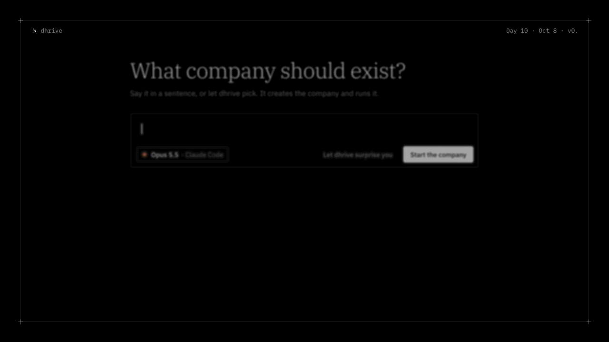

# dhrive

<p align="center">
  
</p>

<p align="center">
  <a href="https://dhrive.app">dhrive.app</a> · <a href="#install">install</a> · <a href="https://dhrive.app/changelog">changelog</a> · <a href="https://discord.gg/wKwzSV3dyJ">discord</a>
</p>

<p align="center">
  <a href="LICENSE.md"></a>
  <a href="https://github.com/hsnrique/dhrive/releases/latest"></a>
  <a href="https://github.com/hsnrique/dhrive/stargazers"></a>
  <a href="https://discord.gg/wKwzSV3dyJ"></a>
</p>

---

**the autonomous ai company.**

say what should exist. dhrive creates the company and runs it, with the ai you already have

<p align="center">
  
</p>

- **one sentence, one company**: describe it and dhrive writes the brief, plans the first delivery and starts building
- **runs on the agents you already pay for**: claude code and codex, with their own sign-in and billing. dhrive never holds an api key
- **an army of agents**: back, front, qa, docs, growth or your own, each on its own cli and model, up to three at once in their own copies of the project
- **a day of work that runs itself**: tasks, documents and a company chat, planned and carried out while you do something else
- **every delivery checked**: lint, typecheck, tests and build after each task. what fails goes back to the agent until it passes
- **ask first, or let it run**: approve each step when you want to, leave it alone when you don't, with mcp on or off
- **a website from day one**: publish to dhrive.site, bring your own domain, every version kept
- **secrets stay in your keychain**: each company's env vars never reach the screen or the repo, and only public ones reach the published site
- **your folder, your git**: a company is a folder on your mac. save it to github in one click
- **native and small**: rust and tauri, no electron

## install

download it at [dhrive.app](https://dhrive.app). macOS on apple silicon, beta, 14 days free

## development

you need rust, node 22, the [tauri cli](https://v2.tauri.app/reference/cli/) and [claude code](https://docs.claude.com/en/docs/claude-code/setup) or [codex](https://developers.openai.com/codex/cli/)

```bash
git clone https://github.com/hsnrique/dhrive
cd dhrive
npm ci --prefix frontend
cargo tauri dev
```

```bash
cargo test --manifest-path src-tauri/Cargo.toml   # backend
npm test --prefix frontend                         # frontend
```

the backend is rust in [`src-tauri/`](src-tauri), where [`engine/`](src-tauri/src/engine) drives each cli. the interface is react in [`frontend/`](frontend)

## agent instructions

if you are an ai agent working on this repository, read [`CONTRIBUTING.md`](CONTRIBUTING.md) before making changes or opening a pull request

## license

dhrive is licensed under the [Functional Source License](LICENSE.md): use it, change it and share it for anything but a competing product. each version becomes apache 2.0 two years after it ships. the dhrive name and logo are trademarks of Cyos Technologies LTDA. notices in [NOTICE.md](NOTICE.md)
